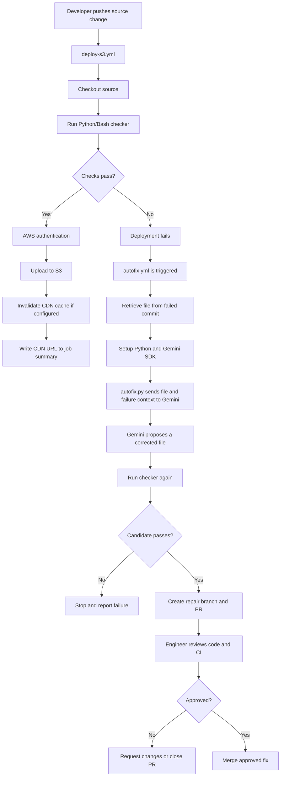

# AI-Assisted Self-Healing CI

> A DevOps project that detects failed source-code checks, asks Google Gemini to propose a repair, validates the candidate, and opens a pull request for an engineer to review.


[](https://github.com/features/actions)
[](https://www.python.org/)
[](https://www.gnu.org/software/bash/)
[](https://ai.google.dev/)

## 1. Project overview

The project combines CI validation, deployment automation, and AI-assisted repair. The normal deployment workflow validates the source before publishing it. If a check fails, a separate repair workflow can retrieve the exact file from the failed commit, provide the file and failure context to Gemini, validate the proposed repair, and create a pull request.

**Important:** the AI does not silently merge or deploy its own code. An engineer reviews the proposed diff and CI results before deciding whether to merge.

## 2. Tools used

| Tool | Purpose |
|---|---|
| **Git** | Tracks code history, commits, branches and changes. |
| **GitHub Actions** | Runs the CI/deployment workflow and the separate repair workflow. |
| **Bash** | Automates shell commands and workflow steps. |
| **Python** | Implements the checker and `autofix.py` agent. |
| **Docker** | Can provide a reproducible local test/package environment when configured; it is not a required stage in the described workflow unless the repository's YAML uses it. |
| **Google Gemini** | Analyses failure context and proposes a corrected file. |
| **AWS S3 + CDN** | Hosts and serves the static website through the configured deployment workflow. |

## 3. Architecture at a glance

There are two workflows:

- **`deploy-s3.yml`** — validates the source and, only on success, performs the configured AWS deployment.
- **`autofix.yml`** — responds to a failed run, invokes `autofix.py`, validates the proposed repair, and opens a PR.



## 4. Workflow A — CI validation and deployment

The deployment flow in `deploy-s3.yml` is designed to work as follows:

1. **Checkout:** GitHub Actions checks out the repository revision associated with the run.
2. **AWS authentication:** the workflow obtains AWS access using the configured authentication method.
3. **Run checker:** the Python checker and/or `check.sh` validates the source before deployment.
4. **Pass/fail decision:**
   - **Pass:** continue to the deployment steps.
   - **Fail:** fail the job at the checker stage and do not publish that invalid revision.
5. **Upload to S3:** after successful checks, upload the static-site files to the configured bucket.
6. **CDN cache invalidation:** invalidate cached content if this step is configured in the workflow.
7. **Job summary:** publish the deployment result and the configured CDN URL in the GitHub Actions summary.

The checker is a **quality gate**: a successful result is required before the deployment stage proceeds.

## 5. How the HTML checker works

The repository includes `check-html.py` and `check.sh`. For the HTML example, the checker can enforce project-specific rules such as:

- required HTML structure, including expected `html`, `head`, and `body` elements;
- expected headings or other required elements;
- opening and closing tags are balanced;
- the required `SITE-OK` marker is present;
- the script exits successfully only when the required checks pass.

The exact behavior depends on the rules implemented in `check-html.py` and the commands called by `check.sh`. These checks are examples of deterministic validation; passing them does not guarantee every aspect of a site is correct.

## 6. Workflow B — AI-assisted repair

When the checker fails, the separate `autofix.yml` workflow performs the repair process:

1. **Trigger:** a failed deployment run triggers the repair workflow according to its configured event.
2. **Checkout context:** the workflow checks out the trusted workflow code and retrieves the target source file from the failed commit.
3. **Prepare Python:** install Python dependencies, including the Google Gemini SDK.
4. **Read the secret:** `autofix.py` reads the Gemini API key from GitHub Actions Secrets.
5. **Collect context:** the agent provides Gemini with the failed file, checker instructions, and relevant failure output.
6. **Generate a candidate:** Gemini returns a proposed corrected file.
7. **Validate again:** the checker runs against the proposed file. A candidate that fails validation must not be treated as a successful repair.
8. **Create a PR:** if validation succeeds, the workflow creates a repair branch and opens a pull request.
9. **Human review:** an engineer reviews the diff and CI checks, then merges only if the fix is correct.

### Example scenario

**Before:** `index.html` is missing a required closing tag, so `check-html.py` exits with a failure. The deployment workflow stops before the upload stage.

**Repair:** the agent sends the failed version and checker output to Gemini. Gemini proposes a corrected file. The checker validates the candidate, and the workflow opens a PR with the proposed change.

**After:** the engineer checks the PR diff and CI status. If it is correct, the engineer merges it; the normal deployment workflow can then deploy the approved revision.

## 7. Repository structure

Based on the supplied project tree:

```text
AI-Assisted Self-Healing CI/
├── .github/
│   ├── scripts/
│   │   └── autofix.py       # Gemini-powered repair agent
│   └── workflows/
│       ├── autofix.yml      # AI repair and PR workflow
│       └── deploy-s3.yml    # Validation and deployment workflow
├── .gitignore
├── check-html.py            # HTML validation rules
├── check.sh                 # Shell-based check entry point
└── index.html               # Example website/source file
```

## 8. Key files

| File | Responsibility |
|---|---|
| `.github/workflows/deploy-s3.yml` | Orchestrates checkout, validation, AWS deployment, cache invalidation, and summary output as configured. |
| `.github/workflows/autofix.yml` | Orchestrates the AI repair process and PR creation. |
| `.github/scripts/autofix.py` | Calls Gemini, extracts a proposed file, validates it, and prepares the repair branch/PR. |
| `check-html.py` | Contains the HTML-specific validation rules. |
| `check.sh` | Provides a shell entry point for checks. |
| `index.html` | The example static website and repair target. |

## 9. Configuration and secrets

Before running the project, confirm the variable names in the workflow and Python script.

- **`GEMINI_API_KEY`:** add it under **GitHub repository → Settings → Secrets and variables → Actions → New repository secret**. Never hardcode it or commit it.
- **`GEMINI_MODEL`:** use a model ID supported by the Gemini API for your account.
- **AWS configuration:** use the region, S3 bucket, CDN distribution, and authentication method configured in `deploy-s3.yml`. Prefer short-lived credentials through GitHub OIDC where supported.
- **GitHub permissions:** grant the minimum permissions needed. PR creation may also require enabling **Allow GitHub Actions to create and approve pull requests** in repository Actions settings.

If an API key was ever committed, revoke/rotate it. Removing it from the latest version of the file does not remove it from Git history.

## 10. Test the project safely

1. Clone the repository and inspect both workflow files and the checker.
2. Run the checker locally against a known-good file.
3. In a **test branch**, introduce a small intentional error, such as a missing closing tag.
4. Push the test branch and inspect the deployment workflow logs. Confirm the checker fails and deployment does not proceed.
5. Inspect the repair workflow logs. Confirm it retrieves the failed revision and calls Gemini.
6. Confirm the candidate is checked again before a PR is opened.
7. Review the PR diff and verify that only the intended file changed.
8. Merge only after manual review; then verify that the approved revision deploys successfully.

Do not intentionally break production source to test the workflow.

## 11. Security and reliability principles

- Treat AI-generated content as **untrusted input**.
- Re-run deterministic checks before opening a PR.
- Restrict the agent to an explicit list of files it is allowed to modify.
- Never print API keys, AWS credentials, or GitHub tokens in logs.
- Use least-privilege workflow permissions and AWS roles.
- Limit retries and repair attempts to prevent loops.
- Keep repair separate from deployment; require review before the generated change reaches production.

## 12. What this project demonstrates

- CI/CD workflow design with GitHub Actions
- Git version control and pull-request collaboration
- Bash and Python automation
- Automated source validation and failure handling
- Integration with Google Gemini
- AWS S3 and CDN deployment concepts
- Human-in-the-loop review for safer AI-assisted remediation

## 13. Limitations and future improvements

- A checker only detects the rules implemented in it.
- Gemini may return an incorrect or incomplete patch; validation and human review remain necessary.
- Simple tag checks are not the same as a complete standards-compliant HTML validator.
- Add file-specific validators for Python, YAML, JSON, and other source types rather than using one generic checker for every language.
- Add unit tests, structured logs, bounded retries, and before/after test evidence.
- Use Docker for a pinned and reproducible test environment if required by the project.

## Conclusion

This project demonstrates a controlled self-healing CI pattern:

**Detect failure → collect context → ask AI for a repair → validate the candidate → open a pull request → require human review.**

The goal is to reduce diagnosis and repair time without allowing AI to bypass quality gates or engineering ownership.

---

**Repository:** [AI-Assisted Self-Healing CI](https://github.com/suren00-77-99/Ci-Automation-AI)
